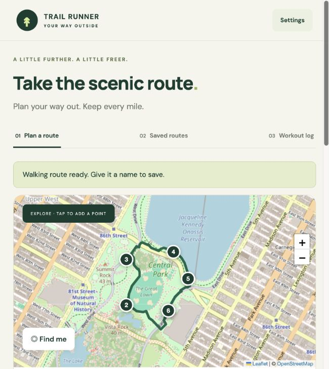

# Trail Runner

A mobile-friendly running app for planning routes, recording foreground GPS runs, and reviewing workouts week by week.

**[Live demo](https://iquarter11.github.io/trail-runner/)** · [Web source](web/dist/) · [Tests](web/tests/)



## Try the demo

1. Tap two or more points on the map. The default mapped-path mode snaps your route automatically without an account or API token.
2. Name and save your route, then reopen it from **Saved routes**.
3. Open **Workout log** and log a run to see weekly mileage and pace.

GPS permission is only requested when you choose **Find me** or start a run. Routes and workouts are stored locally; routing waypoints are sent to the selected routing provider.

The active implementation is in **web/**. The earlier Expo native scaffold remains at the repository root as a reference.

## Open the app

Open https://iQuarter11.github.io/trail-runner/. No ChatGPT account or login is required. Open it in Safari on your iPhone, then choose **Share → Add to Home Screen**. No Apple Developer membership or App Store install is needed.

The map, mapped walking routes, workout log, and weekly summaries work without an account. Walking routing uses the public FOSSGIS / OSRM foot service. Optionally enter a **public** Mapbox token (`pk.…`) in Settings to use Mapbox instead. Mapbox usage is subject to its account limits and billing. Never use a secret token (`sk.…`).

## Features

- Pan/zoom an OpenStreetMap map and tap 2–25 shaping points.
- Follow mapped pedestrian paths automatically between shaping points, using FOSSGIS / OSRM or optional Mapbox. Manual straight-line trace remains available explicitly.
- Save, view, and delete named routes in browser storage.
- Record GPS runs while the app stays visible; pause, resume, finish, and recover an unfinished run after reload.
- Show GPS accuracy, cumulative distance, average pace, and a visual off-route warning after three accepted fixes more than 60 m from the planned line.
- Manually log workouts with distance, duration, date, and optional elevation gain.
- Review Monday-based weekly mileage, run counts, weighted average pace, elevation totals when available, and prior-week mileage comparisons.
- Export routes and workouts as a JSON backup.

## Current limits

- **Keep your phone unlocked and this app visible during GPS recording.** It pauses when the page is hidden. A browser cannot guarantee tracking under suspension; reload recovers the latest checkpoint as paused.
- Routes and workouts are local to the browser and device. They do not sync and can be lost if browser data is cleared. Export periodically. Backup import is not implemented yet.
- Trace mode joins points directly; it does not snap to paths. Place points along the actual route. Walking routing needs internet and depends on mapped connectivity and access tags. It can include roads, and cannot guarantee an exact or exclusively trail route. Waypoints snap within 100 m; missing paths or service failures produce an error rather than a straight-line fallback.
- Maps need internet. The service worker caches the local shell, not third-party map tiles, Leaflet, or map routes. Offline mapping is not implemented.
- Route elevation preview, automatically measured run elevation, and live spoken turn prompts are not implemented. Walking directions are listed for review; off-route alerts are visual while active.
- GPS filtering skips poor accuracy (>40 m), large time gaps (>30 seconds), and implausible jumps (>10 m/s). Outdoor phone testing is still required; pace is average pace, not instantaneous pace.

## Local development

No framework install or build is required for the web app.

```sh
cd web
npm start
```

Open http://localhost:4173 on your Mac. For GPS on your iPhone, use the HTTPS deployed link rather than a plain HTTP LAN address. Secure contexts are required for geolocation.

```sh
cd web
npm run check
npm test
```

The six Node tests cover distance/off-route geometry, weekly boundaries and weighted pace, browser-storage failure handling, and walking API behavior. Browser QA checks route persistence, workout totals, map rendering, and narrow screens. Actual GPS tracking needs outdoor device testing with location permission.

## Technical decisions

The active web app uses plain JavaScript modules, HTML/CSS, and Leaflet. It needs no package installation or framework build. OpenStreetMap supplies map tiles; FOSSGIS / OSRM foot routing is the default; Mapbox walking directions are an optional integration.

- **Local-first storage:** routes and workouts stay in the visitor's browser. Writes update the UI only after storage succeeds, and JSON export provides a backup.
- **Geospatial calculations:** haversine distance measures mileage; point-to-segment distance compares GPS fixes with the planned route. Repeated off-route fixes help reduce false warnings.
- **GPS lifecycle:** recording filters inaccurate fixes and implausible jumps, checkpoints unfinished runs, and pauses when the page becomes hidden.
- **Weekly aggregation:** Monday-based boundaries group workouts; average pace uses total elapsed time divided by total distance. Missing elevation is shown as unavailable.
- **Static deployment:** GitHub Pages serves the web app over HTTPS, with relative paths for its project subdirectory.

This is an MVP. The domain calculations have automated tests and the UI has been checked in a browser; GPS reliability still needs outdoor device validation.

## Hosting and code

The web app is static HTML/CSS/JavaScript, hosted on GitHub Pages from the `docs/` directory of the `main` branch. The source lives in `web/dist/`. Nothing in the active app depends on ChatGPT or Sites. Anyone can open the site; each visitor's data stays in their own browser.

After editing the web source, run `npm run prepare-pages` from `web/`, commit both `web/dist/` and `docs/`, then push `main`. GitHub republishes the `docs/` output automatically. All links, the manifest, and the service worker use relative paths for the `/trail-runner/` deployment path.

- `web/dist/index.html`: accessible responsive screens and dialogs.
- `web/dist/style.css`: mobile and desktop layout.
- `web/dist/app.js`: map UI, local storage, workout forms, and GPS lifecycle.
- `web/dist/core.js`: routing, distance, off-route geometry, and weekly calculations.
- `web/dist/sw.js`: local shell cache.
- `web/tests/core.test.mjs`: calculation and failure tests.

OpenStreetMap attribution is visible on the map. FOSSGIS routing attribution and a Fix the map link are shown in the planner. The public walking service is limited to one request per second, with no heavy usage; requests are debounced and throttled. Use a dedicated routing provider for larger deployments. Standard tiles are used on demand with browser caching; no bulk downloads or offline tile prefetching. For larger usage, choose a suitable tile provider.

The earlier native Expo dependencies have 29 audit findings documented in the previous milestone. The dependency-free web application does not bundle those native packages; they remain relevant if resuming native development.

## Official references

- [FOSSGIS walking routing](https://routing.openstreetmap.de/about.html)
- [Leaflet](https://leafletjs.com/reference.html)
- [OpenStreetMap tile usage policy](https://operations.osmfoundation.org/policies/tiles/)
- [Mapbox walking Directions API](https://docs.mapbox.com/api/navigation/directions/)
- [Browser geolocation](https://developer.mozilla.org/en-US/docs/Web/API/Geolocation/watchPosition)
